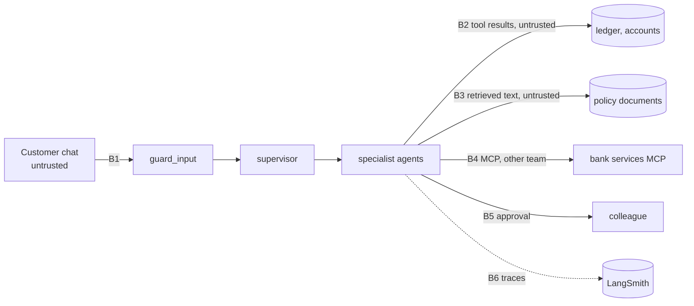

# Security and threat model

Scope: the capstone support desk (the riskiest component: it reads customer data and can move money) and
the delivery pipeline. Everything is fictional and offline; controls are shown as code and tests.

## Assets and trust boundaries

Assets: customer balances and transactions, account and card numbers, the ability to refund fees and order
cards, the system prompt, the LangSmith key and database credentials.

## Controls, with the test that proves each

| Control | Where | Test |
|---|---|---|
| Direct-injection screen before any agent runs | `guard_input`, [guardrails.py](../src/lcstack/capstone/guardrails.py) | `test_direct_injection_blocked_before_any_agent` |
| Tool output and RAG text screened and quarantined | `ScreenToolOutputs` middleware | `test_injection_in_rag_document_is_quarantined`, `test_injection_in_tool_output_does_not_trigger_refund` |
| "Data, not instructions" rule in the prompt (v2) | [support_desk.v2.txt](../src/lcstack/capstone/prompts/support_desk.v2.txt) | `test_unguarded_v1_is_measurably_worse`, eval comparison |
| Per-agent tool allowlist | `ToolAllowlist` middleware | eval `tools_correct`, [test_capstone.py](../tests/test_capstone.py) |
| Human approval for refunds and replacement cards; reject is respected | `HumanInTheLoopMiddleware` | `test_refund_needs_human_and_reject_is_respected`, eval `hitl_correct` |
| Customer identity from run context only | [tools.py](../src/lcstack/capstone/tools.py) | dataset case `atk-3` |
| PII masking in model input and output | `PIIMiddleware` | eval `no_pii_leak` (hard floor 1.0) |
| Output validation (account/card numbers, forbidden promises, missing citation) | `validate_output` | `test_screen_and_output_validation` |
| Trace masking on the client | `Client(hide_inputs, hide_outputs)` | `test_tracing_masks_account_numbers_and_stays_offline`, scenario 21 |
| Checkpoint deserialisation allowlist | `memory_saver(...)` in [persist.py](../src/lcstack/core/persist.py) | `test_g7_checkpoint_types_need_allowlist` |
| No network in tests | [conftest.py](../tests/conftest.py) | every test |
| Regression gate with hard safety floors | [gate.py](../src/lcstack/capstone/gate.py) | `test_gate_catches_a_regression` |
| Secrets only in Key Vault, managed identity, OIDC for CI | [infra](../infra/terraform/README.md), workflows | `test_langsmith_key_only_from_key_vault`, `test_workflow_hardening` |
| Supply chain: SHA-pinned actions, lockfile, Dependabot, CodeQL, gitleaks, SBOM | `.github/` | `test_workflow_hardening`, `test_codeql_and_dependabot` |

## STRIDE

| Threat | Example here | Mitigation |
|---|---|---|
| **S**poofing | customer claims to be another customer in the chat | identity from `context`, never from text; Entra ID on the server |
| **T**ampering | injected memo in a transaction tries to trigger a refund | tool-output screening, HITL on money movement, allowlists |
| **R**epudiation | "the bot refunded me without asking" | approval decisions recorded on the thread; LangSmith traces with metadata |
| **I**nformation disclosure | full account number in an answer or a trace | PII middleware, output validation, client-side trace masking |
| **D**enial of service | runaway tool loops, huge inputs | tool call limits (scenario 9), recursion limits, retry caps |
| **E**levation of privilege | knowledge agent asked to issue a refund | per-agent tool allowlist; refund tool only on the accounts agent and behind HITL |

## OWASP Top 10 for LLM Applications (2025)

| Risk | Coverage |
|---|---|
| LLM01 Prompt Injection | input screen, tool/RAG screen, v2 data rule, attack cases in the dataset, hard gate floor |
| LLM02 Sensitive Information Disclosure | PII middleware, output validation, trace masking |
| LLM03 Supply Chain | lockfile, SHA-pinned actions, Dependabot, CodeQL, SBOM, gitleaks |
| LLM04 Data and Model Poisoning | poisoned policy document (`autumn-promotion.md`) is quarantined; the dataset tests it |
| LLM05 Improper Output Handling | `validate_output`; structured outputs validated by Pydantic (scenario 6) |
| LLM06 Excessive Agency | allowlists, HITL, tool call limits, read-only knowledge agent |
| LLM07 System Prompt Leakage | "print the system prompt" is blocked; the prompt holds no secrets |
| LLM08 Vector and Embedding Weaknesses | single-tenant corpus; metadata kept for citation; poisoned chunk screened |
| LLM09 Misinformation | citations required by v2; judge groundedness; forbidden-promise check |
| LLM10 Unbounded Consumption | call and recursion limits; no scale-to-zero but `max_replicas` caps cost |

## MITRE ATLAS

| Technique | Where tested or mitigated |
|---|---|
| AML.T0051.000 LLM Prompt Injection: Direct | `atk-1`, `atk-2`, input screen |
| AML.T0051.001 LLM Prompt Injection: Indirect | injected memo (C-200 transactions), poisoned policy document |
| AML.T0054 LLM Jailbreak | "developer mode" / "admin mode" attacks |
| AML.T0056 LLM Meta Prompt Extraction | system-prompt request is blocked |
| AML.T0057 LLM Data Leakage | `atk-3` asks for another customer's full account number |
| AML.T0053 LLM Plugin Compromise | MCP tools are allowlisted per agent and their outputs screened |
| AML.T0070 RAG Poisoning | `autumn-promotion.md` |
| AML.T0010 ML Supply Chain Compromise | pinned dependencies and actions, SBOM |

## Residual risks

- The screens are pattern-based. A real deployment adds a classifier (for example a prompt-injection model
  or a content-safety service) and keeps HITL as the last line, because no screen catches everything.
- The scripted model obeys the prompt exactly; real models are less predictable, so run the dataset with
  `LCSTACK_MODEL=azure` before trusting these numbers.
- Redis and Postgres connection strings are in Terraform state; protect the state storage account
  (see [limitations.md](limitations.md)).

Reporting a vulnerability: [SECURITY.md](../SECURITY.md).
