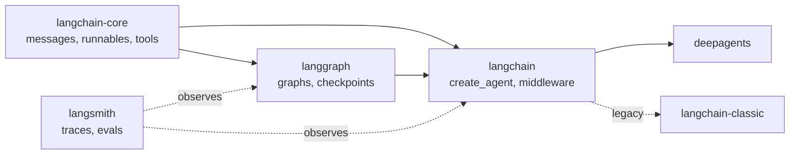

# 01 The Ecosystem

<!-- generated by scripts/render_docs.py; edit scripts/scenario_notes.py or the module docstring -->

**Concept:** Package map: langchain, langchain-core, langgraph, langsmith, deepagents, integrations, langchain-classic  
**Client (fictional):** Wrenfield Grocers: platform dependency audit (retail)  
**Code:** [`src/lcstack/scenarios/s01_ecosystem.py`](../../src/lcstack/scenarios/s01_ecosystem.py)  
**Run:** `lcstack run 01`

## Purpose

which package does what, proven against the installed versions.

Client: Wrenfield Grocers' platform team is standardising its agent stack and wants a dependency audit
that says, for every LangChain-family package, what it is for and whether the symbols the teams rely on
really live there in the installed version (not in a blog post from two versions ago).

## Flow



## How it works

- Each package entry names the symbols teams depend on; the audit imports them from the installed version and reports what was found.
- `create_agent_is_a_graph` shows that the 1.x agent is a compiled LangGraph graph, so everything in sections 11-20 applies to it.

## Code excerpts

`audit`:

```python
def audit() -> list[dict]:
    rows = []
    for dist, role, symbol, layer in PACKAGES:
        try:
            ver = version(dist)
        except PackageNotFoundError:
            ver = "not installed"
        mod, _, attr = symbol.partition(":")
        try:
            ok = hasattr(importlib.import_module(mod), attr)
        except ImportError:
            ok = False
        rows.append({"package": dist, "version": ver, "layer": layer, "role": role, "symbol": symbol, "importable": ok})
    return rows
```

`create_agent_is_a_graph`:

```python
def create_agent_is_a_graph() -> str:
    """create_agent returns a compiled LangGraph graph, which is why it inherits checkpoints and interrupts."""
    from langchain.agents import create_agent

    from lcstack.core.scripted import scripted

    agent = create_agent(scripted(), tools=[])
    return f"{type(agent).__module__}.{type(agent).__name__}"
```

## Real output

Produced by `lcstack run 01` with the offline scripted model (no API keys). Regenerate with `python scripts/render_docs.py`.

```text
Wrenfield Grocers - LangChain ecosystem audit (installed versions)

package                        version    layer         symbol check
langchain-core                 1.6.9      base          langchain_core.runnables:Runnable OK
langchain                      1.4.4      agents        langchain.agents:create_agent OK
langgraph                      1.2.14     runtime       langgraph.graph:StateGraph OK
langsmith                      0.14.7     observability langsmith:Client OK
deepagents                     0.7.23     agents        deepagents:create_deep_agent OK
langchain-openai               1.7.0      integration   langchain_openai:AzureChatOpenAI OK
langchain-mcp-adapters         0.3.2      integration   langchain_mcp_adapters.client:MultiServerMCPClient OK
langchain-text-splitters       1.1.3      retrieval     langchain_text_splitters:RecursiveCharacterTextSplitter OK
langgraph-checkpoint-sqlite    3.1.1      persistence   langgraph.checkpoint.sqlite:SqliteSaver OK
langgraph-checkpoint-postgres  3.1.2      persistence   langgraph.checkpoint.postgres:PostgresSaver OK
langchain-classic              1.0.8      legacy        langchain_classic.agents:AgentExecutor OK

create_agent(...) returns: langgraph.graph.state.CompiledStateGraph
Legacy chains and AgentExecutor import only from langchain_classic; new code uses create_agent or a graph.
```

## Tests

- `tests/test_scenarios.py`: `test_scenario_runs_and_is_deterministic`, `test_scenario_has_readme_and_module`

## Gotchas

- Integration packages (`langchain-openai`, ...) are versioned separately from `langchain`; pin both.
- Chains, memory classes and `AgentExecutor` now live in `langchain-classic`, not `langchain`.

## Interview points

- langchain-core is the contract layer; langgraph is the runtime; langchain 1.x is the opinionated agent layer on top.
- LangSmith is framework-agnostic: `@traceable` works on plain Python.

---

Section titles follow the *LangChain & LangGraph Cheat Sheet* by AI Engineering Insider; all text and code here are original.
