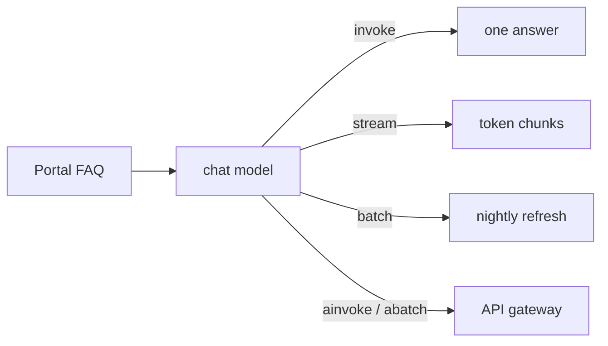

# 03 Install and Chat Models

<!-- generated by scripts/render_docs.py; edit scripts/scenario_notes.py or the module docstring -->

**Concept:** init_chat_model provider strings; invoke, stream, batch, ainvoke/abatch; usage metadata  
**Client (fictional):** Halsey Vale Health: patient-portal FAQ answers (healthcare)  
**Code:** [`src/lcstack/scenarios/s03_chat_models.py`](../../src/lcstack/scenarios/s03_chat_models.py)  
**Run:** `lcstack run 03`

## Purpose

one interface for every provider; invoke, stream, batch and async.

Client: Halsey Vale Health's patient portal answers short administrative questions (parking, visiting
hours, how to request records). The same model object serves the chat window (stream), the nightly
FAQ refresh (batch) and the API gateway (async, many requests in flight).

## Flow



## How it works

- `init_chat_model` turns a `provider:model` string into a chat model; the table shows the strings for the providers a client might use.
- One model object serves invoke, stream, batch and the async variants; usage metadata is read from the AI message.

## Code excerpts

`provider_table`:

```python
def provider_table() -> list[tuple[str, str, bool]]:
    return [(p, pkg, importlib.util.find_spec(pkg) is not None) for p, pkg in PROVIDERS.items()]
```

`_async_demo`:

```python
async def _async_demo(m) -> tuple[list[str], list[str]]:
    qs = ["Where do I park?", "When can I visit?", "How do I get my records?"]
    gathered = await asyncio.gather(*(m.ainvoke(q) for q in qs))
    batched = await m.abatch(qs)
    return [g.content for g in gathered], [b.content for b in batched]
```

## Real output

Produced by `lcstack run 03` with the offline scripted model (no API keys). Regenerate with `python scripts/render_docs.py`.

```text
Halsey Vale Health - patient-portal FAQ through one chat-model interface

init_chat_model("<provider>:<model>") picks the integration package from the prefix:
  azure_openai:...     -> langchain_openai         installed
  openai:...           -> langchain_openai         installed
  anthropic:...        -> langchain_anthropic      installed
  google_genai:...     -> langchain_google_genai   installed
  bedrock_converse:... -> langchain_aws            not installed (pip install it to use)
  ollama:...           -> langchain_ollama         not installed (pip install it to use)

invoke : Visitor parking is in the North garage; the first two hours are free with a validated ticket.
         usage_metadata (simulated count): {'input_tokens': 5, 'output_tokens': 23, 'total_tokens': 28}
stream : 15 chunks -> 'General wards welcome visitors from 9:00 to 20:00, two at a time per bedside.'
batch  :
  - The outpatient pharmacy on level 1 is open 8:00 to 18:00 on weekdays.
  - Request your records through the portal's Records tab; most requests are fulfilled in five working days.
  - Please call the front desk for that question; I can only answer portal and visiting questions.
async  : asyncio.gather over 3 ainvoke calls -> 3 answers; abatch -> 3 answers; identical: True
total model calls: 11
```

## Tests

- `tests/test_scenarios.py`: `test_scenario_runs_and_is_deterministic`, `test_scenario_has_readme_and_module`

## Gotchas

- `batch` runs requests concurrently; set `max_concurrency` to respect provider rate limits.
- Token counts in this repo come from the scripted model and are not provider numbers.

## Interview points

- Provider-agnostic code means swapping Azure OpenAI for another provider is a config change (`LCSTACK_MODEL`).
- Async matters when one process serves many conversations.

---

Section titles follow the *LangChain & LangGraph Cheat Sheet* by AI Engineering Insider; all text and code here are original.
