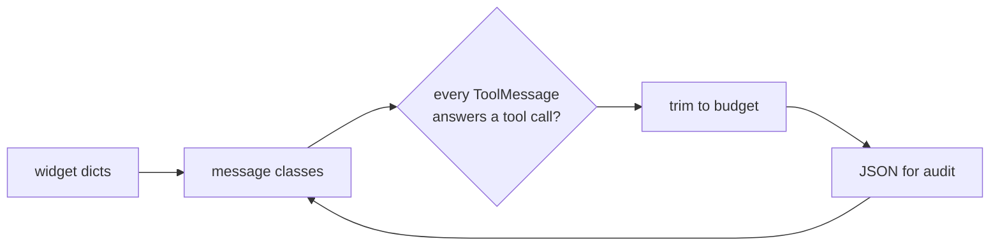

# 04 Messages

<!-- generated by scripts/render_docs.py; edit scripts/scenario_notes.py or the module docstring -->

**Concept:** System/Human/AI/Tool messages, dict form, multimodal blocks, tool_call_id pairing, trimming, serialisation  
**Client (fictional):** Quillmere Home Loans: borrower chat transcripts for audit (mortgage)  
**Code:** [`src/lcstack/scenarios/s04_messages.py`](../../src/lcstack/scenarios/s04_messages.py)  
**Run:** `lcstack run 04`

## Purpose

the common currency between models, tools and graphs.

Client: Quillmere Home Loans stores borrower chats for audit. Transcripts arrive as plain dicts from
the web widget, contain an uploaded pay-stub image, and include tool calls to the rate-lock system.
The scenario normalises them into message classes, checks that every ToolMessage answers a real tool
call, trims long histories to a budget and round-trips them to JSON for the audit store.

## Flow



## How it works

- Dict-form messages from the web widget are normalised into typed messages, including an image content block.
- A check pairs each ToolMessage with its AIMessage tool call by `tool_call_id`.
- `trim_messages` keeps the newest history within a budget, starting on a human turn; messages round-trip through JSON.

## Code excerpts

`build_transcript`:

```python
def build_transcript() -> list[BaseMessage]:
    msgs = convert_to_messages(WIDGET_TRANSCRIPT)
    msgs.append(AIMessage(content="", tool_calls=[{"name": "get_rate_lock", "args": {"loan_id": "QH-4471"}, "id": "call_lock_1"}]))
    msgs.append(
        ToolMessage(content='{"loan_id": "QH-4471", "rate": 6.125, "expires": "in 9 days"}', tool_call_id="call_lock_1", name="get_rate_lock")
    )
    msgs.append(AIMessage(content="Your 6.125% lock on QH-4471 expires in 9 days.",
                          usage_metadata={"input_tokens": 61, "output_tokens": 14, "total_tokens": 75}))  # fmt: skip
    msgs.append(HumanMessage(content=[
        {"type": "text", "text": "Here is my latest pay stub, is it enough for underwriting?"},
        {"type": "image", "url": "https://files.example/quillmere/paystub-QH-4471.png"},
    ]))  # fmt: skip
    return msgs
```

`unanswered_or_orphaned`:

```python
def unanswered_or_orphaned(msgs: list[BaseMessage]) -> dict[str, list[str]]:
    """Every tool call must be answered by a ToolMessage with the same id, and vice versa."""
    calls = {tc["id"] for m in msgs if isinstance(m, AIMessage) for tc in m.tool_calls}
    answers = {m.tool_call_id for m in msgs if isinstance(m, ToolMessage)}
    return {"unanswered_calls": sorted(calls - answers), "orphan_tool_messages": sorted(answers - calls)}
```

## Real output

Produced by `lcstack run 04` with the offline scripted model (no API keys). Regenerate with `python scripts/render_docs.py`.

```text
Quillmere Home Loans - borrower transcript as LangChain messages

SystemMessage "You are Quillmere's loan assistant. Never quote a rate you d"
HumanMessage  'Hi, I locked my rate last month. When does the lock expire? '
AIMessage     '' tool_calls=[('get_rate_lock', {'loan_id': 'QH-4471'})]
ToolMessage   '{"loan_id": "QH-4471", "rate": 6.125, "expires": "in 9 days"' tool_call_id=call_lock_1
AIMessage     'Your 6.125% lock on QH-4471 expires in 9 days.'
HumanMessage  'Here is my latest pay stub, is it enough for underwriting? ' blocks=['text', 'image']

pairing check: {'unanswered_calls': [], 'orphan_tool_messages': []}
pairing check on a truncated copy: {'unanswered_calls': ['call_lock_1'], 'orphan_tool_messages': []}
usage on the final answer: {'input_tokens': 61, 'output_tokens': 14, 'total_tokens': 75}
trim to 60 tokens, keep system, start on a human turn: ['SystemMessage', 'HumanMessage']
filter to system + human: 3 messages
JSON round trip for the audit store: 1615 bytes, equal after reload: True
```

## Tests

- `tests/test_scenarios.py`: `test_scenario_runs_and_is_deterministic`, `test_scenario_has_readme_and_module`

## Gotchas

- A ToolMessage without its matching tool call is rejected by most providers.
- Trimming can split a tool call from its result; trim on turn boundaries.

## Interview points

- Messages are the common currency between models, tools and graphs.
- Store transcripts in the serialised message format so they can be replayed.

---

Section titles follow the *LangChain & LangGraph Cheat Sheet* by AI Engineering Insider; all text and code here are original.
