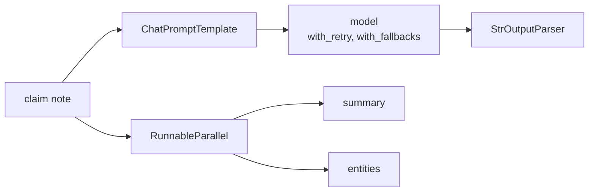

# 05 Prompts and LCEL

<!-- generated by scripts/render_docs.py; edit scripts/scenario_notes.py or the module docstring -->

**Concept:** ChatPromptTemplate, prompt | model | parser, with_retry, with_fallbacks, RunnableParallel, bind_tools  
**Client (fictional):** Ferrowind Insurance: claim-note summaries per audience (insurance)  
**Code:** [`src/lcstack/scenarios/s05_prompts_lcel.py`](../../src/lcstack/scenarios/s05_prompts_lcel.py)  
**Run:** `lcstack run 05`

## Purpose

compose runnables with the pipe; retry, fall back, fan out, bind tools.

Client: Ferrowind Insurance claim handlers write long notes. Leadership, the customer and the fraud
unit each need a different summary, the primary model endpoint is flaky, and the fraud unit wants
entity extraction run alongside the summary in one call.

## Flow



## How it works

- One prompt template per audience feeds a model piped into a parser.
- `with_retry` absorbs transient failures of the primary endpoint and `with_fallbacks` switches to a backup model.
- `RunnableParallel` produces the summary and the entity extraction in one call; `bind_tools` attaches a policy lookup.

## Code excerpts

`get_policy`:

```python
@tool
```

## Real output

Produced by `lcstack run 05` with the offline scripted model (no API keys). Regenerate with `python scripts/render_docs.py`.

```text
Ferrowind Insurance - claim note summaries with LCEL

chain: ChatPromptTemplate | ScriptedChatModel | StrOutputParser
  executives      Water loss, est. 8,900.00 exposure; repeat loss at address - review recommended.
  the customer    We have your claim for the kitchen water damage and are reviewing the plumber and contractor documents.
  the fraud unit  Repeat water loss within 14 months; amounts 1,240.00, 8,900.00; verify hose failure with the plumber.

with_retry: first call timed out, second succeeded after 2 calls -> Water loss, est. 8,900.00 exposure; repeat loss at address - review recommended.
with_fallbacks: primary failed (1 call), backup answered (1 call) -> We have your claim for the kitchen water damage and are reviewing the plumber and contractor documents.

RunnableParallel (one input, three branches):
  summary: Repeat water loss within 14 months; amounts 1,240.00, 8,900.00; verify hose failure with the plumber.
  fraud_flags: repeat_loss
  amounts: ['1,240.00', '8,900.00']

bind_tools -> the model asks for a tool: [('get_policy', {'claim_id': 'FW-20931'})]
```

## Tests

- `tests/test_scenarios.py`: `test_scenario_runs_and_is_deterministic`, `test_scenario_has_readme_and_module`

## Gotchas

- `with_fallbacks` only triggers on exceptions, not on a poor answer.
- Retrying non-idempotent calls can duplicate side effects.

## Interview points

- LCEL is still the right tool for fixed pipelines with no agent loop.
- Every runnable gets invoke, stream, batch and async for free.

---

Section titles follow the *LangChain & LangGraph Cheat Sheet* by AI Engineering Insider; all text and code here are original.
