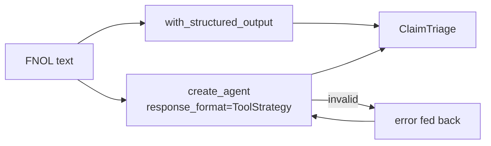

# 06 Structured Output

<!-- generated by scripts/render_docs.py; edit scripts/scenario_notes.py or the module docstring -->

**Concept:** with_structured_output(Pydantic), include_raw, create_agent(response_format=ToolStrategy) with error retry  
**Client (fictional):** Ferrowind Insurance: FNOL claim triage into a typed record (insurance)  
**Code:** [`src/lcstack/scenarios/s06_structured_output.py`](../../src/lcstack/scenarios/s06_structured_output.py)  
**Run:** `lcstack run 06`

## Purpose

typed, validated results with Pydantic, from a model and from an agent.

Client: Ferrowind Insurance first-notice-of-loss (FNOL) triage. Every new claim must come out as a
``ClaimTriage`` record (line of business, severity 1-5, fraud signal, next action) that the claims
system can store without a human retyping it. Invalid output must never reach the queue.

## Flow



## How it works

- `with_structured_output(ClaimTriage)` returns a validated Pydantic object; `include_raw=True` also keeps the raw message.
- In an agent, `ToolStrategy` turns the schema into a tool; an invalid first attempt is fed back as an error and the model corrects it.

## Code excerpts

`ClaimTriage`:

```python
class ClaimTriage(BaseModel):
    """Triage record for a first notice of loss."""

    line: Literal["auto", "property", "liability", "travel"]
    severity: int = Field(ge=1, le=5, description="1 = minor, 5 = catastrophic or bodily injury")
    fraud_signal: bool = Field(description="True when the notice contains a known fraud indicator")
    next_action: Literal["fast_track", "adjuster_visit", "special_investigations", "medical_review"]
    summary: str = Field(max_length=160)
```

`_sloppy_then_fixed`:

```python
def _sloppy_then_fixed(turn: Turn) -> dict:
    """First attempt overshoots severity (10); after the validation error comes back, it corrects itself."""
    data = triage_rules(turn.last_human)
    errored = any(isinstance(m, ToolMessage) and "error" in str(m.content).lower() for m in turn.messages)
    return data if errored else {**data, "severity": 10}
```

## Real output

Produced by `lcstack run 06` with the offline scripted model (no API keys). Regenerate with `python scripts/render_docs.py`.

```text
Ferrowind Insurance - FNOL triage into ClaimTriage

line       sev fraud  next_action             notice
auto         2 False  fast_track              Rear-ended at a red light on the ring road, bumper c
property     4 False  adjuster_visit          Burst pipe flooded the basement overnight, furniture
liability    5 False  medical_review          Customer slipped on a wet floor in our client's shop
travel       3 True   special_investigations  Luggage lost on a connecting flight, contents listed
auto         4 True   special_investigations  Car fire in the driveway at 3am, policy started 9 da

include_raw on a bad answer: parsed=None, error=ValidationError at ('severity',) (Input should be less than or equal to 5)

create_agent(response_format=ToolStrategy(ClaimTriage, handle_errors=True)):
  tool policy_status -> active; inception 9 days ago
  tool ClaimTriage  -> Error: Failed to parse structured output for tool 'ClaimTriage': Failed to parse data to ClaimTr
  tool ClaimTriage  -> Returning structured response: line='auto' severity=4 fraud_signal=True next_action='special_inv
  structured_response: line=auto severity=4 fraud=True next=special_investigations
  model calls: 3 (tool call, invalid answer, corrected answer)
```

## Tests

- `tests/test_scenarios.py`: `test_scenario_runs_and_is_deterministic`, `test_scenario_has_readme_and_module`

## Gotchas

- Validation errors must reach the model as feedback, not crash the run.
- Field descriptions are part of the prompt; vague ones give vague output.

## Interview points

- Typed outputs are what let an LLM step feed a system of record.
- Prefer provider-native structured output when available; ToolStrategy works everywhere.

---

Section titles follow the *LangChain & LangGraph Cheat Sheet* by AI Engineering Insider; all text and code here are original.
