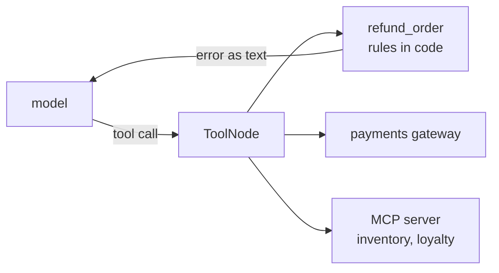

# 07 Tools

<!-- generated by scripts/render_docs.py; edit scripts/scenario_notes.py or the module docstring -->

**Concept:** @tool, docstring and type hints as schema, errors as text vs raising, ToolNode error handling, MCP via langchain-mcp-adapters  
**Client (fictional):** Wrenfield Grocers: order-refund agent with an MCP inventory server (retail)  
**Code:** [`src/lcstack/scenarios/s07_tools.py`](../../src/lcstack/scenarios/s07_tools.py)  
**Run:** `lcstack run 07`

## Purpose

functions the model can call, schemas from docstrings, errors as text, MCP tools.

Client: Wrenfield Grocers' online order-refund agent. Refund rules (30-day window, no double refunds,
cap per order) live in the tools, not the prompt. Tool errors that the model can act on come back as
text; a real outage raises. Store inventory and loyalty points come from a separate team's MCP server.

## Flow



## How it works

- `@tool` builds the schema from type hints and the docstring; refund rules are enforced in the function.
- Recoverable errors return text the model can act on; an outage raises, and ToolNode's error handling decides what the model sees.
- `langchain-mcp-adapters` loads tools from a stdio MCP server (`s07_mcp_server.py`).

## Code excerpts

`refund_order`:

```python
@tool
```

`tool_node_graph`:

```python
def tool_node_graph(*, handle_errors: bool):
    """A one-node graph around ToolNode (ToolNode needs the graph runtime to execute)."""
    b = StateGraph(MessagesState)
    b.add_node("tools", ToolNode([payments_gateway_health], handle_tool_errors=handle_errors))
    b.add_edge(START, "tools")
    return b.compile()
```

`mcp_demo`:

```python
async def mcp_demo() -> list[str]:
    from langchain_mcp_adapters.client import MultiServerMCPClient

    client = MultiServerMCPClient({"inventory": {"transport": "stdio", "command": sys.executable, "args": [str(MCP_SERVER)]}})
    tools = await client.get_tools()
    agent = create_agent(scripted(PLAYBOOK, name="refund-agent"), tools)
    res = await agent.ainvoke({"messages": [{"role": "user", "content": "Is oats in stock at Riverside, and how many points do I have?"}]})
    return [f"MCP tools loaded over stdio: {sorted(t.name for t in tools)}", f"agent answer: {res['messages'][-1].content}"]
```

## Real output

Produced by `lcstack run 07` with the offline scripted model (no API keys). Regenerate with `python scripts/render_docs.py`.

```text
Wrenfield Grocers - refund tools

schema the model sees for refund_order: name='refund_order'
  description: Refund one order in full. Only orders under 30 days old that were not already refunded qualify.
  args: {'order_id': {'title': 'Order Id', 'type': 'string'}, 'reason': {'title': 'Reason', 'type': 'string'}}
  Please refund WG-1001    -> Refunded WG-1001: 54.20 back to the original card (customer request).
  Please refund WG-0988    -> I could not do that: order WG-0988 is 41 days old, outside the 30-day window. Offer store credit instead.
  Please refund WG-0950    -> I could not do that: order WG-0950 was already refunded. Do not refund it again.
  Please refund WG-7777    -> I could not do that: order WG-7777 not found. Ask the customer to confirm the order number.
refunds actually issued: ['WG-1001']

a raised ToolException, caught by ToolNode(handle_tool_errors=True): status='error' content="Error: ToolException('payments gateway unreachable (simulated outage)')\n Please fix your mistakes."
handle_tool_errors=False: the run fails with ToolException(payments gateway unreachable (simulated outage))

MCP tools loaded over stdio: ['loyalty_points', 'store_inventory']
agent answer: SKU-OATS-1KG at Riverside: 14 units on the shelf. Customer C-118 has 2310 points.
```

## Tests

- `tests/test_scenarios.py`: `test_scenario_runs_and_is_deterministic`, `test_scenario_has_readme_and_module`

## Gotchas

- A tool that raises on a user mistake ends the run; return a message instead.
- MCP tools are async; call the agent with `ainvoke`.

## Interview points

- Business rules belong in tools, where they are testable, not in the prompt.
- MCP lets another team own a tool server without sharing code.

---

Section titles follow the *LangChain & LangGraph Cheat Sheet* by AI Engineering Insider; all text and code here are original.
