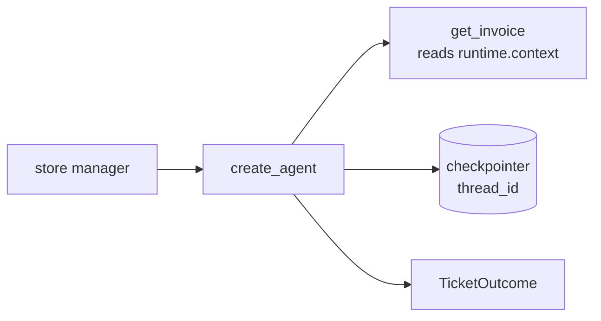

# 08 create_agent

<!-- generated by scripts/render_docs.py; edit scripts/scenario_notes.py or the module docstring -->

**Concept:** create_agent with tools, system_prompt, checkpointer, context_schema (ToolRuntime) and response_format  
**Client (fictional):** Wrenfield Grocers: billing-ticket agent for store managers (retail)  
**Code:** [`src/lcstack/scenarios/s08_create_agent.py`](../../src/lcstack/scenarios/s08_create_agent.py)  
**Run:** `lcstack run 08`

## Purpose

a production agent in a dozen lines, with memory per thread and per-run context.

Client: Wrenfield Grocers' billing-ticket agent for store managers. The agent must remember the ticket
conversation (checkpointer + thread_id), know which store and user it is acting for without trusting
the chat text (context_schema read by tools), and return a typed ticket outcome (response_format).

## Flow



## How it works

- Tools read the store and user from `runtime.context` (the `context_schema`), not from chat text.
- A checkpointer plus `thread_id` gives each ticket its own memory; `response_format` returns a typed outcome.

## Code excerpts

`StoreCtx`:

```python
@dataclass
```

`get_invoice`:

```python
@tool
```

`build`:

```python
def build(checkpointer=None):
    model = scripted(PLAYBOOK, name="billing-agent")
    agent = create_agent(
        model=model,
        tools=[get_invoice],
        system_prompt="You resolve store billing tickets. Only discuss the caller's own store.",
        context_schema=StoreCtx,
        response_format=TicketOutcome,
        checkpointer=checkpointer or memory_saver(TicketOutcome),
    )
    return agent, model
```

## Real output

Produced by `lcstack run 08` with the offline scripted model (no API keys). Regenerate with `python scripts/render_docs.py`.

```text
Wrenfield Grocers - billing-ticket agent built with create_agent

turn 1 structured_response: {'invoice_id': 'INV-5521', 'status': 'overdue', 'action': 'none'}
turn 2 (same thread, invoice id not repeated): {'invoice_id': 'INV-5521', 'status': 'overdue', 'action': 'payment_plan_offered'}
messages stored on the thread: 8
store-12 asking about store-40's INV-7710 -> {'invoice_id': 'INV-7710', 'status': 'not_found', 'action': 'none'} (context, not chat text, scopes the tool)
new thread_id, follow-up only -> invoice_id='' (no memory on a new thread)
model calls: 6
```

## Tests

- `tests/test_scenarios.py`: `test_scenario_runs_and_is_deterministic`, `test_scenario_has_readme_and_module`

## Gotchas

- Without a checkpointer the agent forgets the previous turn.
- Never let the model pass the tenant id as an argument; read it from context.

## Interview points

- create_agent is a small, production-ready loop; extend it with middleware before writing a graph.
- Context is per-run and trusted; state is per-thread and model-visible.

---

Section titles follow the *LangChain & LangGraph Cheat Sheet* by AI Engineering Insider; all text and code here are original.
