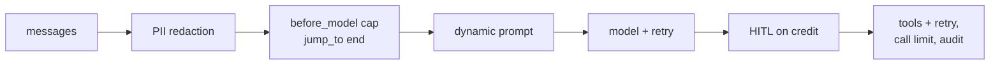

# 09 Middleware

<!-- generated by scripts/render_docs.py; edit scripts/scenario_notes.py or the module docstring -->

**Concept:** before_model with jump_to, HumanInTheLoop, PII, Model/ToolRetry, ToolCallLimit, wrap_tool_call, dynamic_prompt, Summarization  
**Client (fictional):** Kestrel Ridge Bank: card-dispute agent under compliance controls (banking)  
**Code:** [`src/lcstack/scenarios/s09_middleware.py`](../../src/lcstack/scenarios/s09_middleware.py)  
**Run:** `lcstack run 09`

## Purpose

customise the agent loop without forking it.

Client: Kestrel Ridge Bank's card-dispute agent. Compliance asked for: card numbers and emails never
reach the model; provisional credits need a human; flaky model and fraud-score calls are retried; a
runaway conversation is cut off; every tool call is audit-logged; premium customers get a different
prompt; long histories are summarised. Each requirement is one middleware.

## Flow



## How it works

- Each compliance requirement is one middleware: PII redaction, a turn cap using `jump_to`, a tier-based prompt, model and tool retry, a tool call limit, an audit wrapper, HITL on credits, and summarisation.
- The run shows which middleware fired for each request.

## Code excerpts

`cap_turns`:

```python
@before_model(can_jump_to=["end"])
```

`audit_log`:

```python
@wrap_tool_call
```

`tiered_prompt`:

```python
@dynamic_prompt
```

## Real output

Produced by `lcstack run 09` with the offline scripted model (no API keys). Regenerate with `python scripts/render_docs.py`.

```text
Kestrel Ridge Bank - dispute agent with ten middleware

system prompt the model got (dynamic_prompt, premium): 'You handle card disputes for Kestrel Ridge Bank. Premium customer: offer a call-back within 1 hour.'
user text the model got (PII middleware): 'I want to dispute TX-55120. Card **** **** **** 1111, email [REDACTED_EMAIL], account <account_number_hash:bc2a6702>.'
ModelRetryMiddleware: first model call timed out, run continued (model calls so far: 4)
ToolRetryMiddleware: fraud_score attempts = 2 (1 timeout + 1 success)
HumanInTheLoop paused before: issue_provisional_credit({'account': 'ACC-ending-0042', 'amount': 89.0})
reviewer edited the amount to 45.00 -> Dispute opened. TX-55120: fraud score 91. Provisional credit of 45.00 posted to ACC-ending-0042.

audit trail (wrap_tool_call):
  lookup_transaction({'txn_id': 'TX-55120'}) -> success
  fraud_score({'txn_id': 'TX-55120'}) -> success
  issue_provisional_credit({'account': 'ACC-ending-0042', 'amount': 45.0}) -> success

ToolCallLimitMiddleware(run_limit=3): 3 lookups ran, 1 blocked; last: Tool call limit exceeded. Do not call 'lookup_transaction' again.
SummarizationMiddleware: 31 messages in, model saw 7; first: 'Here is a summary of the conversation to date:\n\nSummary: cus'
cap_turns (before_model, jump_to end) on a 61-message thread: 'This conversation is too long; a colleague will follow up.'
```

## Tests

- `tests/test_scenarios.py`: `test_scenario_runs_and_is_deterministic`, `test_scenario_has_readme_and_module`

## Gotchas

- Middleware order matters: redact before anything logs or summarises.
- Async agents need middleware with async hooks (`awrap_tool_call`).

## Interview points

- Middleware keeps cross-cutting controls out of business tools.
- Built-in middleware covers most compliance asks; custom hooks cover the rest.

---

Section titles follow the *LangChain & LangGraph Cheat Sheet* by AI Engineering Insider; all text and code here are original.
