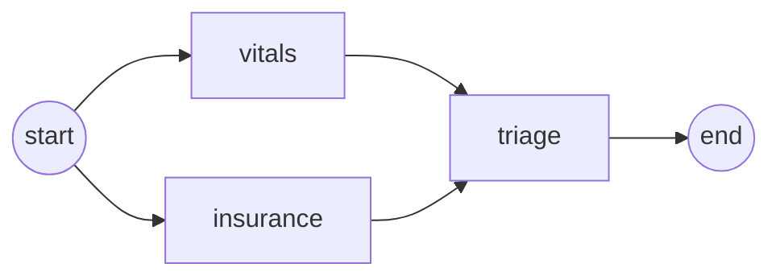

# 11 LangGraph Mental Model

<!-- generated by scripts/render_docs.py; edit scripts/scenario_notes.py or the module docstring -->

**Concept:** Shared state, nodes as functions returning partial updates, fixed edges, fan-out/fan-in, super-steps, a checkpoint per step  
**Client (fictional):** Halsey Vale Health: emergency-department intake (healthcare)  
**Code:** [`src/lcstack/scenarios/s11_mental_model.py`](../../src/lcstack/scenarios/s11_mental_model.py)  
**Run:** `lcstack run 11`

## Purpose

shared state, nodes that return partial updates, edges, super-steps.

Client: Halsey Vale Health's emergency-department intake. When a patient registers, vitals scoring and
insurance eligibility run at the same time (they do not depend on each other), then a triage node
combines both. The scenario shows that the two run in one super-step and that state is checkpointed
after every step.

## Flow



## How it works

- Nodes are plain functions that return partial state updates.
- Vitals and insurance run in the same super-step; triage waits for both.
- State history shows one checkpoint per super-step.

## Code excerpts

`vitals`:

```python
def vitals(s: Intake) -> dict:
    score = (2 if s["heart_rate"] > 110 else 0) + (3 if s["systolic"] < 90 else 0)
    return {"news_score": score}
```

`insurance`:

```python
def insurance(s: Intake) -> dict:
    return {"eligible": s["payer"] in {"Halsey Vale Plan", "State Medicaid", "Northcoast Mutual"}}
```

`triage`:

```python
def triage(s: Intake) -> dict:
    acuity = "resuscitation bay" if s["news_score"] >= 5 else "urgent" if s["news_score"] >= 2 else "standard"
    return {"acuity": acuity + ("" if s["eligible"] else " (financial counselling referral)")}
```

`build`:

```python
def build():
    b = StateGraph(Intake)
    b.add_node("vitals", vitals)
    b.add_node("insurance", insurance)
    b.add_node("triage", triage)
    b.add_edge(START, "vitals")
    b.add_edge(START, "insurance")  # fan out: both start in the same super-step
    b.add_edge(["vitals", "insurance"], "triage")  # fan in: triage waits for both
    b.add_edge("triage", END)
    return b.compile(checkpointer=InMemorySaver())
```

## Real output

Produced by `lcstack run 11` with the offline scripted model (no API keys). Regenerate with `python scripts/render_docs.py`.

```text
Halsey Vale Health - ED intake graph

graph (mermaid, generated from the compiled graph):
  	__start__ --> insurance;
  	__start__ --> vitals;
  	insurance --> triage;
  	vitals --> triage;
  	triage --> __end__;

stream_mode='updates' (each node returns only the keys it owns):
  {'insurance': {'eligible': False}}
  {'vitals': {'news_score': 5}}
  {'triage': {'acuity': 'resuscitation bay (financial counselling referral)'}}

checkpoints, oldest first (step -> nodes scheduled next):
  step -1: next=('__start__',)
  step  0: next=('vitals', 'insurance')
  step  1: next=('triage',)
  step  2: next=()
final state: acuity='resuscitation bay (financial counselling referral)', news_score=5, eligible=False
```

## Tests

- `tests/test_scenarios.py`: `test_scenario_runs_and_is_deterministic`, `test_scenario_has_readme_and_module`

## Gotchas

- Two parallel nodes writing the same key need a reducer.
- A node returning the whole state can overwrite a sibling's update.

## Interview points

- Think in super-steps: everything scheduled together runs together, then state is merged and saved.
- Checkpoints per step are what make HITL and time travel possible.

---

Section titles follow the *LangChain & LangGraph Cheat Sheet* by AI Engineering Insider; all text and code here are original.
