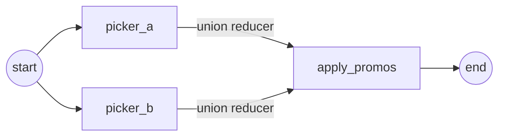

# 12 State and Reducers

<!-- generated by scripts/render_docs.py; edit scripts/scenario_notes.py or the module docstring -->

**Concept:** add_messages (merge by id, RemoveMessage), operator.add, plain overwrite, a custom reducer, Overwrite to bypass a reducer  
**Client (fictional):** Wrenfield Grocers: basket assistant state (retail)  
**Code:** [`src/lcstack/scenarios/s12_state_reducers.py`](../../src/lcstack/scenarios/s12_state_reducers.py)  
**Run:** `lcstack run 12`

## Purpose

how concurrent and repeated updates are merged.

Client: Wrenfield Grocers' basket-assistant graph. Messages must merge by id (an edited message
replaces, not duplicates), applied promotions accumulate across turns, the route is simply overwritten,
substitutions from two parallel pickers must be combined without duplicates, and at checkout the promo
list must be reset even though its reducer appends.

## Flow



## How it works

- `add_messages` merges by id and supports `RemoveMessage`; `operator.add` accumulates; keys without reducers are overwritten.
- A custom union reducer combines parallel pickers without duplicates; `Overwrite` resets a reducer-managed list at checkout.

## Code excerpts

`union`:

```python
def union(left: list[str] | None, right: list[str] | None) -> list[str]:
    """Custom reducer: sorted set union, so two pickers suggesting the same substitute count once."""
    return sorted(set(left or []) | set(right or []))
```

`Basket`:

```python
class Basket(TypedDict, total=False):
    messages: Annotated[list, add_messages]  # append, merge by id
    promos: Annotated[list[str], add]  # concatenate
    substitutions: Annotated[list[str], union]  # custom
    route: str  # no reducer: last write wins
```

`apply_promos`:

```python
def apply_promos(s: Basket) -> dict:
    return {"promos": ["MEMBER5"], "route": "checkout"}
```

## Real output

Produced by `lcstack run 12` with the offline scripted model (no API keys). Regenerate with `python scripts/render_docs.py`.

```text
Wrenfield Grocers - basket state and reducers

turn 1: promos=['MEMBER5'] substitutions=['free-range eggs x6', 'oat milk 1L', 'rye bread'] route='checkout' messages=1
turn 2: promos=['MEMBER5', 'MEMBER5']  <- operator.add appended again (state grows every run)
edit message m1 (same id): messages=2, first='Add oat milk and bread'  <- add_messages replaced it
RemoveMessage(id='m2'): messages=1
update_state(promos=['STAFF10']) goes through the reducer: ['MEMBER5', 'MEMBER5', 'STAFF10']
update_state(promos=Overwrite(['STAFF10'])) bypasses it: ['STAFF10']
custom union reducer merged two parallel pickers without duplicates: ['free-range eggs x6', 'oat milk 1L', 'rye bread']
```

## Tests

- `tests/test_scenarios.py`: `test_scenario_runs_and_is_deterministic`, `test_scenario_has_readme_and_module`

## Gotchas

- Appending reducers grow across turns on the same thread.
- Parallel writes to a key without a reducer raise an error.

## Interview points

- Reducers are the concurrency model of LangGraph state.
- Choose the reducer per key, based on how concurrent and repeated writes should combine.

---

Section titles follow the *LangChain & LangGraph Cheat Sheet* by AI Engineering Insider; all text and code here are original.
