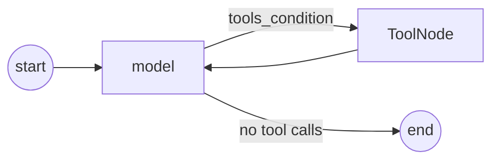

# 13 A ReAct Graph by Hand

<!-- generated by scripts/render_docs.py; edit scripts/scenario_notes.py or the module docstring -->

**Concept:** StateGraph(MessagesState) + bind_tools + ToolNode + tools_condition + checkpointer, compared with create_agent  
**Client (fictional):** Ferrowind Insurance: policy-servicing assistant (insurance)  
**Code:** [`src/lcstack/scenarios/s13_react_by_hand.py`](../../src/lcstack/scenarios/s13_react_by_hand.py)  
**Run:** `lcstack run 13`

## Purpose

model node, ToolNode, tools_condition, and the loop between them.

Client: Ferrowind Insurance's policy-servicing assistant. The platform team wanted to see exactly what
create_agent does before adopting it, so the same agent is built by hand with StateGraph and compared
call for call with create_agent.

## Flow



## How it works

- A model node with `bind_tools`, a `ToolNode`, `tools_condition` and an edge back form the ReAct loop.
- The same questions run through `create_agent`; the tool calls and answers match.

## Code excerpts

`build_by_hand`:

```python
def build_by_hand(model):
    llm = model.bind_tools(TOOLS)

    def agent(state: MessagesState) -> dict:
        return {"messages": [llm.invoke(state["messages"])]}

    b = StateGraph(MessagesState)
    b.add_node("agent", agent)
    b.add_node("tools", ToolNode(TOOLS))
    b.add_edge(START, "agent")
    b.add_conditional_edges("agent", tools_condition)  # -> "tools" if the last AI message has tool calls, else END
    b.add_edge("tools", "agent")  # the cycle that makes it ReAct
    return b.compile(checkpointer=InMemorySaver())
```

## Real output

Produced by `lcstack run 13` with the offline scripted model (no API keys). Regenerate with `python scripts/render_docs.py`.

```text
Ferrowind Insurance - ReAct loop by hand vs create_agent

hand-built graph edges:
  __start__ --> agent;
  agent -.-> __end__;
  agent -.-> tools;
  tools --> agent;

transcript (hand-built):
  human When does FW-HO-3381 renew and what would it cost with flood cover?
  call get_policy({'policy_id': 'FW-HO-3381'})
  tool get_policy -> FW-HO-3381: {'holder': 'R. Okafor', 'type': 'hom
  call quote_renewal({'policy_id': 'FW-HO-3381', 'add_flood': True})
  tool quote_renewal -> FW-HO-3381 renewal: 1786.80
  ai Your policy renews in 23 days; 1786.80 including the options you asked for.
same transcript from create_agent: True; model calls hand=3 create_agent=3
create_agent nodes: ['model', 'tools']
```

## Tests

- `tests/test_scenarios.py`: `test_scenario_runs_and_is_deterministic`, `test_scenario_has_readme_and_module`

## Gotchas

- Forgetting the edge from tools back to the model ends the run after the first tool call.
- Bind tools to the model and register the same tools in ToolNode.

## Interview points

- create_agent is this loop plus middleware hooks.
- Build by hand when you need extra nodes in the loop.

---

Section titles follow the *LangChain & LangGraph Cheat Sheet* by AI Engineering Insider; all text and code here are original.
