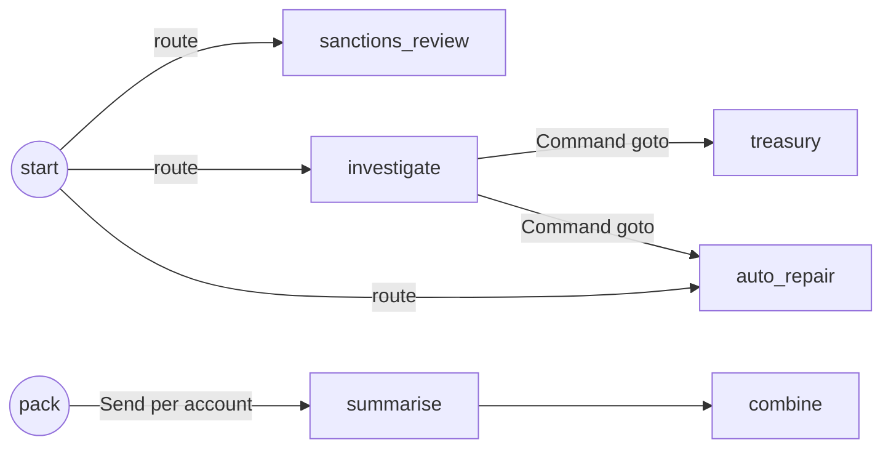

# 14 Control Flow

<!-- generated by scripts/render_docs.py; edit scripts/scenario_notes.py or the module docstring -->

**Concept:** add_conditional_edges with a router, Command(goto, update) with typed destinations, Send map-reduce, one routing method per node  
**Client (fictional):** Kestrel Ridge Bank: payment-exception routing and statement packs (banking)  
**Code:** [`src/lcstack/scenarios/s14_control_flow.py`](../../src/lcstack/scenarios/s14_control_flow.py)  
**Run:** `lcstack run 14`

## Purpose

conditional edges, Command (route and update in one step), and Send (map-reduce).

Client: Kestrel Ridge Bank's payment-operations desk. Incoming payment exceptions are routed by type
and amount; an investigation node both records its finding and decides the next hop; month-end
statement packs are summarised in parallel, one Send per account, then combined.

## Flow



## How it works

- A router function with `add_conditional_edges` sends sanctions hits to review and routes the rest by amount.
- `investigate` returns `Command(update=..., goto=...)`, recording its finding and choosing treasury or auto-repair in one step.
- `Send` maps one summarise task per account and a reducer combines the results.

## Code excerpts

`route`:

```python
def route(s: Exception_) -> Literal["sanctions_review", "investigate", "auto_repair"]:
    if s["kind"] == "sanctions_hit":
        return "sanctions_review"
    return "investigate" if s["amount"] >= 10_000 else "auto_repair"
```

`investigate`:

```python
def investigate(s: Exception_) -> Command[Literal["treasury", "auto_repair"]]:
    """Records a finding AND picks the next node: no static edge leaves this node (one routing method)."""
    if s["kind"] == "returned_wire":
        return Command(update={"finding": "beneficiary account closed", "handled_by": ["investigate"]}, goto="treasury")
    return Command(update={"finding": "format error only", "handled_by": ["investigate"]}, goto="auto_repair")
```

`fan_out`:

```python
def fan_out(s: Pack) -> list[Send]:
    return [Send("summarise", {"account": a}) for a in s["accounts"]]
```

## Real output

Produced by `lcstack run 14` with the offline scripted model (no API keys). Regenerate with `python scripts/render_docs.py`.

```text
Kestrel Ridge Bank - payment exception routing

  sanctions_hit     250.00 -> path ['sanctions_review'] finding='-'
  format_error      900.00 -> path ['auto_repair'] finding='-'
  returned_wire   48000.00 -> path ['investigate', 'treasury'] finding='beneficiary account closed'
  format_error    15500.00 -> path ['investigate', 'auto_repair'] finding='format error only'

Send map-reduce over 5 accounts (one summarise task each, same super-step):
  KR-CHK-000: 10 txns, closing 120.00 LOW BALANCE
  KR-CHK-001: 17 txns, closing 530.00
  KR-CHK-002: 24 txns, closing 940.00
  KR-CHK-003: 31 txns, closing 1350.00
  KR-CHK-004: 38 txns, closing 1760.00
  combine -> 5 statements; 1 flagged
```

## Tests

- `tests/test_scenarios.py`: `test_scenario_runs_and_is_deterministic`, `test_scenario_has_readme_and_module`

## Gotchas

- Do not combine a static edge with Command routing from the same node (see section 23).
- Type the Command destinations so the graph drawing is correct.

## Interview points

- Use one routing mechanism per node.
- Send is LangGraph's map-reduce: the fan-out width is decided at runtime.

---

Section titles follow the *LangChain & LangGraph Cheat Sheet* by AI Engineering Insider; all text and code here are original.
