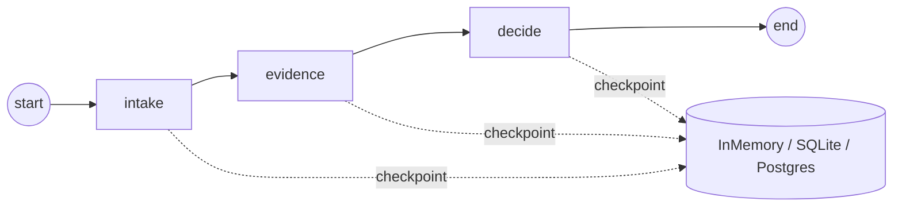

# 15 Persistence

<!-- generated by scripts/render_docs.py; edit scripts/scenario_notes.py or the module docstring -->

**Concept:** thread_id, InMemorySaver / SqliteSaver / PostgresSaver, get_state, get_state_history, update_state, replay and fork from a checkpoint  
**Client (fictional):** Kestrel Ridge Bank: multi-day dispute case workflow (banking)  
**Code:** [`src/lcstack/scenarios/s15_persistence.py`](../../src/lcstack/scenarios/s15_persistence.py)  
**Run:** `lcstack run 15`

## Purpose

threads, checkpoints, inspection, editing, time travel; memory, SQLite and Postgres.

Client: Kestrel Ridge Bank's dispute workflow. A dispute case runs over days: intake, evidence from the
merchant, then a decision. The process restarts between steps, auditors need every intermediate state,
and an operations lead occasionally needs to correct a field and replay from an earlier step.

## Flow



## How it works

- Each step is checkpointed under the case's `thread_id`; a new process with a new SQLite connection continues the case.
- `get_state_history` gives auditors every intermediate state; `update_state` corrects a field and the run is replayed from that checkpoint as a fork.
- With `DATABASE_URL` set, the same graph runs on `PostgresSaver` (CI uses a Postgres service container).

## Code excerpts

`sqlite_restart_demo`:

```python
def sqlite_restart_demo(path: Path) -> list[str]:
    """Run the first step, 'restart' (new connection and new graph object), and continue from disk."""
    with sqlite3.connect(path, check_same_thread=False) as conn:
        g1 = builder().compile(checkpointer=SqliteSaver(conn), interrupt_after=["intake"])
        g1.invoke({"case_id": "D-4410", "amount": 312.40}, {"configurable": {"thread_id": "D-4410"}})
    with sqlite3.connect(path, check_same_thread=False) as conn:
        g2 = builder().compile(checkpointer=SqliteSaver(conn))
        cfg = {"configurable": {"thread_id": "D-4410"}}
        before = g2.get_state(cfg)
        final = g2.invoke(None, cfg)
    return [
        f"  after restart the saved thread was waiting at next={before.next}",
        f"  resumed to the end: decision={final['decision']!r}, log={final['log']}",
    ]
```

`postgres_demo`:

```python
def postgres_demo(url: str) -> list[str]:
    from langgraph.checkpoint.postgres import PostgresSaver

    with PostgresSaver.from_conn_string(url) as saver:
        saver.setup()  # creates the checkpoint tables once (idempotent)
        g = builder().compile(checkpointer=saver)
        cfg = {"configurable": {"thread_id": "D-PG-1"}}
        g.invoke({"case_id": "D-PG-1", "amount": 75.0}, cfg)
        n = len(list(g.get_state_history(cfg)))
        return [f"  PostgresSaver: decision={g.get_state(cfg).values['decision']!r}, checkpoints={n}"]
```

## Real output

Produced by `lcstack run 15` with the offline scripted model (no API keys). Regenerate with `python scripts/render_docs.py`.

```text
Kestrel Ridge Bank - dispute case persistence

InMemorySaver: values.decision='refund customer' next=()
history: 5 checkpoints, newest first: [3, 2, 1, 0, -1]
checkpoint before 'decide': merchant_response='no response in 10 days'
fork: update_state on that checkpoint, then invoke(None) -> decision='decline dispute'
replay the original checkpoint unchanged -> decision='refund customer'
latest state on the thread is now the replay: 'refund customer'
a thread that never ran has empty values: {}

SqliteSaver (file on disk, survives a restart):
  after restart the saved thread was waiting at next=('evidence',)
  resumed to the end: decision='refund customer', log=['intake D-4410 for 312.40', 'evidence requested', 'decided']

PostgresSaver (production):
  skipped here: set DATABASE_URL (CI runs it against a postgres:17 service container)
```

## Tests

- `tests/test_persistence_postgres.py`: `test_postgres_saver_survives_new_connection`, `test_sqlite_saver_survives_restart`
- `tests/test_scenarios.py`: `test_scenario_runs_and_is_deterministic`, `test_scenario_has_readme_and_module`

## Gotchas

- Call `setup()` once on SQLite/Postgres savers to create tables.
- InMemorySaver is lost on restart; use it only in tests.

## Interview points

- Durable execution is a checkpointer plus a thread id.
- Time travel is reading history and resuming from an older checkpoint.

---

Section titles follow the *LangChain & LangGraph Cheat Sheet* by AI Engineering Insider; all text and code here are original.
