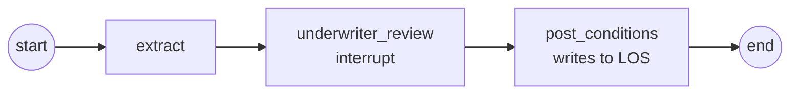

# 16 Human in the Loop

<!-- generated by scripts/render_docs.py; edit scripts/scenario_notes.py or the module docstring -->

**Concept:** interrupt() payloads, __interrupt__, Command(resume=...), approve/edit/reject, idempotent side effects, a checkpointer is required  
**Client (fictional):** Quillmere Home Loans: underwriter approval of document conditions (mortgage)  
**Code:** [`src/lcstack/scenarios/s16_human_in_the_loop.py`](../../src/lcstack/scenarios/s16_human_in_the_loop.py)  
**Run:** `lcstack run 16`

## Purpose

interrupt, inspect, resume with Command; keep side effects idempotent.

Client: Quillmere Home Loans' document review. An extraction step reads the borrower's documents and
proposes conditions; an underwriter must approve, edit or reject before anything is written to the loan
origination system (LOS). The scenario also shows the classic bug: a node that posts to the LOS before
its interrupt posts twice, because on resume the node runs again from its first line.

## Flow



## How it works

- `interrupt()` pauses with a payload describing the proposed conditions; the result has `__interrupt__`.
- `Command(resume=...)` continues with the underwriter's decision.
- Approved or edited conditions are posted by `post_conditions`; a rejection posts nothing. The buggy variant posts to the LOS before its interrupt, and posts twice.

## Code excerpts

`build`:

```python
def build(los: LOS, *, buggy: bool = False):
    def underwriter_review(s: Review) -> dict:
        if buggy:
            los.post(f"{s['loan_id']}: review started")  # side effect BEFORE interrupt: runs again on resume
        else:
            los.post_once(f"{s['loan_id']}:review-started", f"{s['loan_id']}: review started")
        answer = interrupt({"loan_id": s["loan_id"], "proposed_conditions": s["conditions"], "allowed": ["approve", "edit", "reject"]})
        if answer["action"] == "reject":
            return {"decision": "rejected", "conditions": []}
        conditions = answer.get("conditions", s["conditions"])
        return {"decision": "approved" if answer["action"] == "approve" else "edited", "conditions": conditions}

    def post_conditions(s: Review) -> dict:
        for c in s["conditions"]:  # after the interrupt: runs once, with the human's decision
            los.post_once(f"{s['loan_id']}:{c}", f"{s['loan_id']}: condition '{c}'")
        return {"posted": s["conditions"]}

    b = StateGraph(Review)
    b.add_node("extract", extract)
    b.add_node("underwriter_review", underwriter_review)
    b.add_node("post_conditions", post_conditions)
    b.add_edge(START, "extract")
    b.add_edge("extract", "underwriter_review")
    b.add_edge("underwriter_review", "post_conditions")
    b.add_edge("post_conditions", END)
    return b
```

## Real output

Produced by `lcstack run 16` with the offline scripted model (no API keys). Regenerate with `python scripts/render_docs.py`.

```text
Quillmere Home Loans - underwriter review with interrupt

paused: next=('underwriter_review',); payload proposed 3 conditions
resumed with an edit -> decision='edited', posted=['verify 2 most recent pay stubs', 'gift letter for 20,000.00', 'verify employment by phone']
LOS writes (idempotent node): 4 -> 'QH-5120: review started' + 3 conditions
reject path -> decision='rejected', conditions posted=[], LOS writes=1
non-idempotent version: 'review started' written 2 times (the node re-ran from its first line on resume)
no checkpointer: the pause happens (True) but resuming fails: Cannot use Command(resume=...) without checkpointer
```

## Tests

- `tests/test_scenarios.py`: `test_scenario_runs_and_is_deterministic`, `test_scenario_has_readme_and_module`

## Gotchas

- A resumed node runs again from its first line.
- Without a checkpointer an interrupt cannot be resumed.

## Interview points

- Put side effects after the interrupt, or make them idempotent.
- HITL is a checkpoint plus a resume value, so the human can answer hours later.

---

Section titles follow the *LangChain & LangGraph Cheat Sheet* by AI Engineering Insider; all text and code here are original.
