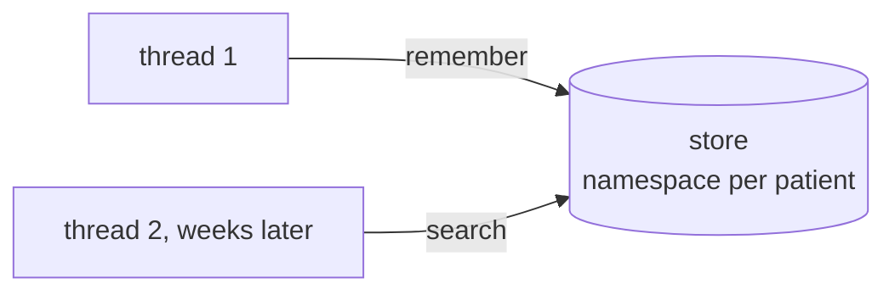

# 17 Long-Term Memory

<!-- generated by scripts/render_docs.py; edit scripts/scenario_notes.py or the module docstring -->

**Concept:** InMemoryStore with an embedding index, namespaces per user, runtime.store in nodes and tools, context_schema, cross-thread recall  
**Client (fictional):** Halsey Vale Health: appointment-scheduling assistant that remembers preferences (healthcare)  
**Code:** [`src/lcstack/scenarios/s17_long_term_memory.py`](../../src/lcstack/scenarios/s17_long_term_memory.py)  
**Run:** `lcstack run 17`

## Purpose

stores that persist across threads, scoped by namespace, searchable by meaning.

Client: Halsey Vale Health's appointment-scheduling assistant. A patient says once that they prefer
morning appointments and need step-free access; weeks later, in a brand-new conversation (a new
thread), the assistant should still know. One patient's preferences must never surface for another.

## Flow



## How it works

- An `InMemoryStore` with an embedding index stores preferences under a namespace per patient.
- Nodes and tools reach it through the runtime; a new thread recalls the preferences by meaning.
- A second patient's search returns nothing from the first patient's namespace.

## Code excerpts

`make_store`:

```python
def make_store() -> InMemoryStore:
    emb = HashingEmbeddings()
    return InMemoryStore(index={"dims": emb.dim, "embed": emb.embed_documents, "fields": ["text"]})
```

`remember`:

```python
def remember(state: MessagesState, runtime: Runtime[Patient]) -> dict:
    """Graph node: save any stated preference into the patient's namespace."""
    text = state["messages"][-1].content
    if re.search(r"\bprefer|\bneed\b", text, re.I):
        ns = ("patients", runtime.context.patient_id, "preferences")
        key = f"pref-{len(runtime.store.search(ns, limit=100)) + 1}"
        runtime.store.put(ns, key, {"text": text})
    return {}
```

`recall_preferences`:

```python
@tool
```

## Real output

Produced by `lcstack run 17` with the offline scripted model (no API keys). Regenerate with `python scripts/render_docs.py`.

```text
Halsey Vale Health - scheduling assistant with long-term memory

store namespaces: [('patients', 'P-301', 'preferences'), ('patients', 'P-302', 'preferences')]
semantic search in P-301 for 'wheelchair access': 'I also need step-free access, I use a wheelchair.' (score 0.32)
P-301, new thread: Based on what you told us before (I also need step-free access, I use a wheelchair. | I prefer morning appointments, before 11.), open slots: Cardiology: Tue 08:40, Thu 10:00
P-303 (never stated anything), new thread: Based on what you told us before (no saved preferences), open slots: Cardiology: Tue 08:40, Tue 14:10, Wed 09:20, Thu 10:00
checkpointer = this conversation's short-term state; store = facts shared across that patient's threads
```

## Tests

- `tests/test_scenarios.py`: `test_scenario_runs_and_is_deterministic`, `test_scenario_has_readme_and_module`

## Gotchas

- Checkpointer memory is per thread; store memory is across threads.
- Scope namespaces by user from trusted context, never from model output.

## Interview points

- Short-term memory is state; long-term memory is a store.
- Production stores are Postgres-backed with the same interface.

---

Section titles follow the *LangChain & LangGraph Cheat Sheet* by AI Engineering Insider; all text and code here are original.
