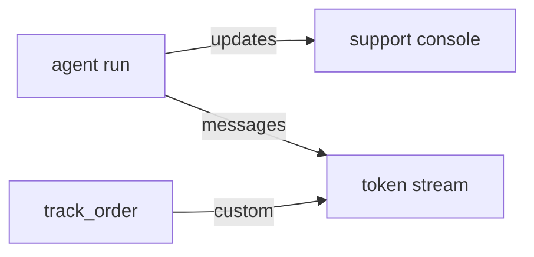

# 18 Streaming

<!-- generated by scripts/render_docs.py; edit scripts/scenario_notes.py or the module docstring -->

**Concept:** stream_mode values / updates / messages / custom / debug, several modes at once, get_stream_writer from a tool, astream  
**Client (fictional):** Wrenfield Grocers: order-tracking assistant in the mobile app (retail)  
**Code:** [`src/lcstack/scenarios/s18_streaming.py`](../../src/lcstack/scenarios/s18_streaming.py)  
**Run:** `lcstack run 18`

## Purpose

show progress, not a spinner.

Client: Wrenfield Grocers' order-tracking assistant in the mobile app. The UI shows "checking your
order..." while tools run (custom events from inside the tool), streams the answer token by token
(messages), and the support console records node-level updates. One run is streamed with several modes
at once and every event is counted.

## Flow



## How it works

- One run is streamed with several modes; each event is tagged with its mode.
- The tool emits progress through `get_stream_writer`, which arrives as `custom` events.

## Code excerpts

`track_order`:

```python
@tool
```

## Real output

Produced by `lcstack run 18` with the offline scripted model (no API keys). Regenerate with `python scripts/render_docs.py`.

```text
Wrenfield Grocers - streaming one run with five modes

events per mode: {'custom': 2, 'debug': 11, 'messages': 16, 'updates': 3, 'values': 4}
custom (from inside the tool): ['contacting the store', 'locating the driver']
updates (node order): ['model', 'tools', 'model']
messages: 13 token chunks from node ['model']: 'Good news: your order is out for delivery and should arrive around 18:40.'
values: 4 full-state snapshots; message count grows [1, 2, 3, 4]
```

## Tests

- `tests/test_scenarios.py`: `test_scenario_runs_and_is_deterministic`, `test_scenario_has_readme_and_module`

## Gotchas

- Token streaming needs a model that streams; the scripted model yields chunks.
- With subgraphs, pass `subgraphs=True` to see their events.

## Interview points

- Streaming is about perceived latency and transparency.
- Use `updates` for logs, `messages` for chat UIs, `custom` for progress.

---

Section titles follow the *LangChain & LangGraph Cheat Sheet* by AI Engineering Insider; all text and code here are original.
