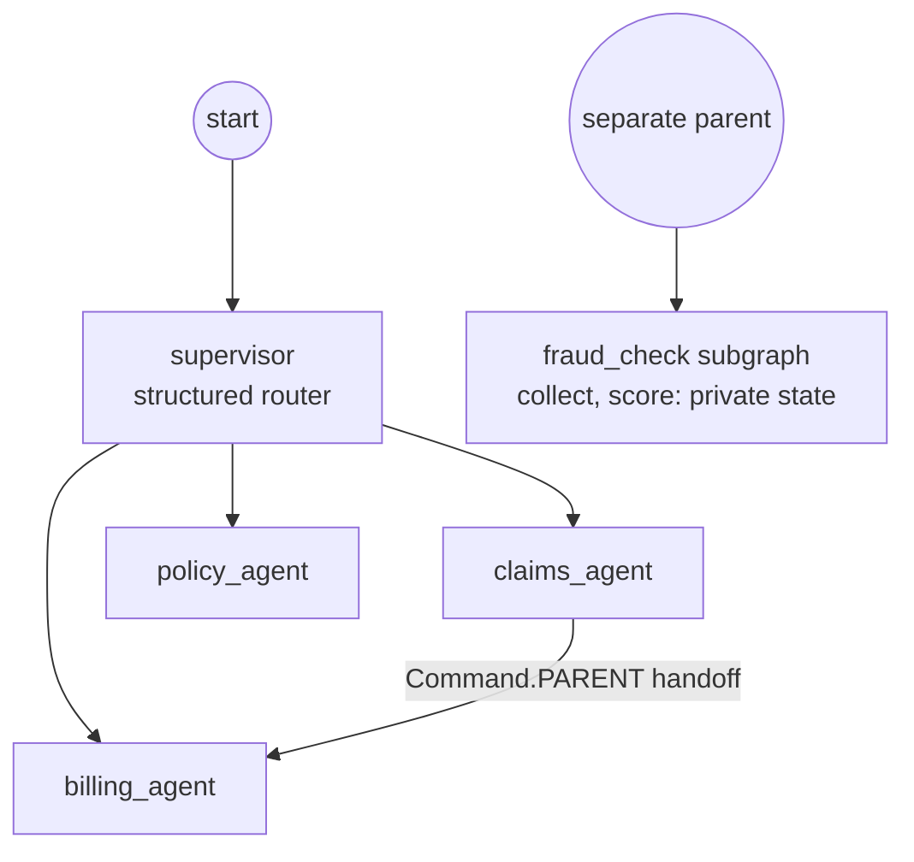

# 19 Subgraphs and Multi-Agent

<!-- generated by scripts/render_docs.py; edit scripts/scenario_notes.py or the module docstring -->

**Concept:** Compiled agents as nodes, a structured-output supervisor router, handoff with Command.PARENT, subgraph private state  
**Client (fictional):** Ferrowind Insurance: supervisor with claims, policy and billing specialists (insurance)  
**Code:** [`src/lcstack/scenarios/s19_multi_agent.py`](../../src/lcstack/scenarios/s19_multi_agent.py)  
**Run:** `lcstack run 19`

## Purpose

compose graphs like functions; supervisor routing and handoffs.

Client: Ferrowind Insurance's customer-service desk. A supervisor reads each message and delegates to a
claims, policy or billing specialist (each its own agent, added to the parent as a node). When the
claims agent learns that a payment is overdue it hands the conversation to billing with
``Command(goto=..., graph=Command.PARENT)``. A fraud-check subgraph keeps its working signals private.

## Flow



## How it works

- A structured-output supervisor picks a specialist; each specialist is a compiled agent added as a node.
- The claims agent hands off to billing with `Command(goto=..., graph=Command.PARENT)`.
- The fraud subgraph has its own state schema; only its verdict reaches the parent.

## Code excerpts

`transfer_to_billing`:

```python
@tool
```

`fraud_subgraph`:

```python
def fraud_subgraph():
    b = StateGraph(FraudState)
    b.add_node("collect", lambda s: {"signals": ["new policy", "high amount"] if "fire" in str(s["messages"][-1].content).lower() else []})
    b.add_node("score", lambda s: {"fraud_flag": len(s["signals"]) >= 2})
    b.add_edge(START, "collect")
    b.add_edge("collect", "score")
    b.add_edge("score", END)
    return b.compile()
```

`build`:

```python
def build():
    router = scripted(Playbook(extractors={"Route": _route}), name="supervisor").with_structured_output(Route)

    def supervisor(state: Desk) -> Command[Literal["claims_agent", "policy_agent", "billing_agent"]]:
        r = router.invoke(state["messages"][-1].content)
        return Command(goto=r.specialist, update={"route": r.specialist})

    b = StateGraph(Desk)
    b.add_node("supervisor", supervisor)
    b.add_node("claims_agent", create_agent(scripted(CLAIMS, name="claims"), [claim_status, transfer_to_billing], name="claims_agent"),
               destinations=("billing_agent",))  # fmt: skip
    b.add_node("policy_agent", create_agent(scripted(POLICY, name="policy"), [coverage], name="policy_agent"))
    b.add_node("billing_agent", create_agent(scripted(BILLING, name="billing"), [balance], name="billing_agent"))
    b.add_edge(START, "supervisor")
    b.add_edge("policy_agent", END)
    b.add_edge("billing_agent", END)
    return b.compile(checkpointer=InMemorySaver())
```

## Real output

Produced by `lcstack run 19` with the offline scripted model (no API keys). Regenerate with `python scripts/render_docs.py`.

```text
Ferrowind Insurance - supervisor and specialists

Q: Is a burst pipe covered by my policy?
   routed to policy_agent; handoffs=[]
   A: Water damage from a sudden pipe burst is covered; gradual leaks are excluded.
Q: When is my premium due and what do I owe?
   routed to billing_agent; handoffs=[]
   A: Billing here: FW-HO-3381: 182.50 overdue; paying it releases any held claim payments within 1 business day.
Q: What's happening with claim CL-7781?
   routed to claims_agent; handoffs=['claims->billing']
   A: Billing here: FW-HO-3381: 182.50 overdue; paying it releases any held claim payments within 1 business day.

fraud subgraph as a node: parent state keys after the run = ['messages'] (private 'signals' and 'fraud_flag' stay inside)
```

## Tests

- `tests/test_scenarios.py`: `test_scenario_runs_and_is_deterministic`, `test_scenario_has_readme_and_module`

## Gotchas

- Handoffs need the destination declared on the parent graph.
- Shared keys between parent and subgraph are passed through; private keys are not.

## Interview points

- Use multi-agent when specialists need different tools or prompts; otherwise one agent is simpler.
- Subgraphs give encapsulation, like functions.

---

Section titles follow the *LangChain & LangGraph Cheat Sheet* by AI Engineering Insider; all text and code here are original.
