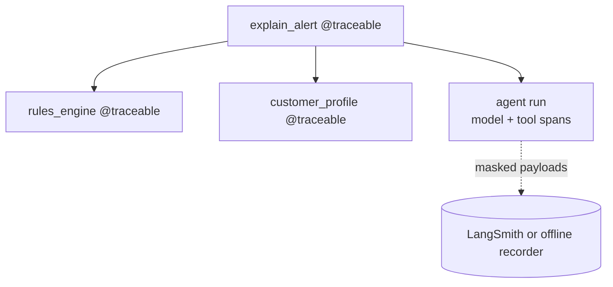

# 21 Tracing with LangSmith

<!-- generated by scripts/render_docs.py; edit scripts/scenario_notes.py or the module docstring -->

**Concept:** LANGSMITH_TRACING / API_KEY / PROJECT, run tree of model/tool/node spans, @traceable for plain code, tags and metadata, input masking, datasets from traces  
**Client (fictional):** Kestrel Ridge Bank: fraud-alert explainer with auditable traces (banking)  
**Code:** [`src/lcstack/scenarios/s21_tracing.py`](../../src/lcstack/scenarios/s21_tracing.py)  
**Run:** `lcstack run 21`

## Purpose

turn it on before you debug.

Client: Kestrel Ridge Bank's fraud-alert explainer. Analysts asked "why did the agent say that?", so
every run must be traceable: model calls, tool calls, graph nodes and the bank's own rules-engine code
(not LangChain) in one tree, tagged by tenant and alert, with account numbers masked before anything
leaves the process. Real LangSmith needs an account; offline, an ``OfflineLangSmithClient`` records the
exact run payloads LangSmith would receive, so the tree, tags, metadata and redaction are testable.

## Flow



## How it works

- Plain bank code is traced with `@traceable` alongside agent spans, tagged by tenant and alert.
- Masking per function (`process_inputs`) misses spans created by the agent; masking on the client (`hide_inputs`/`hide_outputs`) covers every span. The output counts leaking spans for both.
- Offline, `OfflineLangSmithClient` records the exact payloads; with both LangSmith switches set, the real client sends them.

## Code excerpts

`rules_engine`:

```python
@traceable(run_type="tool", name="rules_engine", process_inputs=mask_inputs)
```

`traced`:

```python
def traced(client: OfflineLangSmithClient, alert: str) -> dict:
    with tracing_context(enabled=True, client=client, project_name=os.getenv("LANGSMITH_PROJECT", "kestrel-fraud-alerts"),
                         tags=["fraud-alerts", "tenant:kestrel"], metadata={"alert_id": "AL-9931", "prompt_version": "v2"}):  # fmt: skip
        return explain_alert(alert)
```

`leaks`:

```python
def leaks(client: OfflineLangSmithClient, secret: str) -> list[str]:
    return [r["name"] for r in client.recorded.values() if secret in str(r["inputs"]) or secret in str(r["outputs"])]
```

## Real output

Produced by `lcstack run 21` with the offline scripted model (no API keys). Regenerate with `python scripts/render_docs.py`.

```text
Kestrel Ridge Bank - traced fraud-alert explanation

tracing mode: offline recorder (no LANGSMITH_API_KEY): nothing leaves the process
result: {'rules': ['R12 new device', 'R31 high amount'], 'explanation': "Flagged because the amount is far above this customer's usual spend (9-year customer, usual spend under 400.00, travels rarely)."}

run tree (as LangSmith would store it):
  chain  explain_alert tags=['fraud-alerts', 'tenant:kestrel'] metadata={'alert_id': 'AL-9931', 'prompt_version': 'v2'}
    tool   rules_engine
    chain  fraud_alert_explainer
      chain  model
        llm    ScriptedChatModel
      chain  tools
        tool   customer_profile
      chain  model
        llm    ScriptedChatModel
runs by type: {'chain': 5, 'llm': 2, 'tool': 2}
root inputs as sent (masked): {'alert_text': 'Card payment 2450.00 from a new device, account KR**********'}
process_inputs on @traceable only: spans still holding the raw account number = 5 ['fraud_alert_explainer', 'model', 'ScriptedChatModel']...
Client(hide_inputs=..., hide_outputs=...) masks every span: spans holding it = 0 of 9
dataset example built from the trace: inputs=['alert_text'] outputs=['explanation', 'rules']
```

## Tests

- `tests/test_scenarios.py`: `test_scenario_runs_and_is_deterministic`, `test_scenario_has_readme_and_module`

## Gotchas

- `LANGSMITH_TRACING=true` without an API key causes 401 errors at runtime; this repo checks both.
- Mask on the client, not per function.

## Interview points

- Turn tracing on before debugging, not after.
- Traces become datasets: interesting runs are added as eval examples.

---

Section titles follow the *LangChain & LangGraph Cheat Sheet* by AI Engineering Insider; all text and code here are original.
