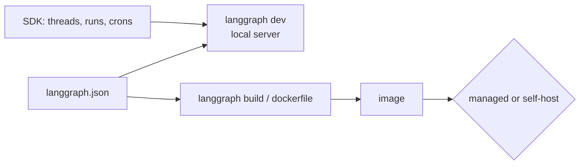

# 22 Deploying

<!-- generated by scripts/render_docs.py; edit scripts/scenario_notes.py or the module docstring -->

**Concept:** langgraph.json, a server-ready graph (no checkpointer: the server provides one), langgraph dockerfile/build, SDK threads/runs/crons, managed vs self-host  
**Client (fictional):** Halsey Vale Health: scheduling assistant behind the Agent Server API (healthcare)  
**Code:** [`src/lcstack/scenarios/s22_deploying.py`](../../src/lcstack/scenarios/s22_deploying.py)  
**Run:** `lcstack run 22`

## Purpose

from notebook to server with langgraph.json, langgraph dev and langgraph build.

Client: Halsey Vale Health wants its appointment-scheduling assistant behind an HTTP API (threads,
runs, streaming, cron) that the patient portal can call. This scenario validates the deployment
configuration and builds the Dockerfile offline; CI then starts the real Agent Server with
``langgraph dev`` and drives it with the SDK (scripts/agent_server_smoke.py). Nothing is deployed to a
cloud: the managed (LangSmith Deployment) and self-hosted (container + Postgres + Redis) paths are
documented in docs/deployment.md, and the Azure Container Apps IaC is written but not applied.

## Flow



## How it works

- `langgraph.json` registers the graphs, dependencies and env file; the config is validated and a Dockerfile is generated offline.
- The server graph is compiled without a checkpointer because the Agent Server supplies one.
- CI starts `langgraph dev` and calls it with the SDK (`scripts/agent_server_smoke.py`). Nothing is deployed.

## Code excerpts

`load_graph`:

```python
def load_graph(spec: str):
    path, _, attr = spec.partition(":")
    mod_path = (ROOT / path).resolve()
    module_spec = importlib.util.spec_from_file_location(f"lgjson_{mod_path.stem}", mod_path)
    module = importlib.util.module_from_spec(module_spec)
    module_spec.loader.exec_module(module)
    return getattr(module, attr)
```

## Real output

Produced by `lcstack run 22` with the offline scripted model (no API keys). Regenerate with `python scripts/render_docs.py`.

```text
Halsey Vale Health - Agent Server deployment check (offline)

langgraph.json validated by langgraph-cli: python 3.13, 2 graphs
  scheduling_assistant   CompiledStateGraph, nodes=['model', 'tools'], checkpointer=none (server provides it)
  support_desk           CompiledStateGraph, nodes=['guard_input', 'supervisor', 'accounts_agent', 'cards_agent', 'knowledge_agent', 'out_of_scope', 'validate_output'], checkpointer=none (server provides it)

Dockerfile generated (what `langgraph build` would build):
  FROM langchain/langgraph-api:3.13
  WORKDIR /deps/langchain-langgraph-langsmith
  9 RUN/ADD/ENV instructions; graphs registered via LANGSERVE_GRAPHS

SDK surface used by the portal (checked against the installed langgraph-sdk):
  client.assistants search, get, create, update
  client.threads    create, get, get_state, update_state, get_history, search
  client.runs       create, wait, stream, join, cancel, list
  client.crons      create, create_for_thread, search, delete
  client.store      put_item, get_item, search_items, delete_item

self-host needs: DATABASE_URI (Postgres), REDIS_URI (Redis), LANGGRAPH_CLOUD_LICENSE_KEY and/or LANGSMITH_API_KEY
managed (LangSmith Deployment): push the repo, LangSmith builds the same image and provides Postgres and Redis
```

## Tests

- `tests/test_scenarios.py`: `test_scenario_runs_and_is_deterministic`, `test_scenario_has_readme_and_module`

## Gotchas

- Compiling the server graph with your own checkpointer conflicts with the server's persistence.
- Self-hosting needs Postgres, Redis and a license or LangSmith key; see docs/deployment.md.

## Interview points

- The Agent Server adds threads, runs, background jobs, crons and streaming over HTTP.
- Managed versus self-host is a data-residency and operations trade-off.

---

Section titles follow the *LangChain & LangGraph Cheat Sheet* by AI Engineering Insider; all text and code here are original.
