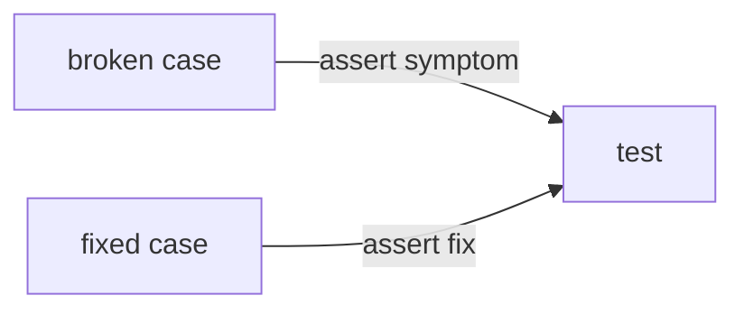

# 23 Gotchas

<!-- generated by scripts/render_docs.py; edit scripts/scenario_notes.py or the module docstring -->

**Concept:** Missing compile, new thread_id per call, recursion limit placement, reducer growth vs Overwrite, static edge + Command double-run, re-run after interrupt, checkpoint type allowlist  
**Client (fictional):** Halsey Vale Health: pharmacy refill workflow, broken then fixed (healthcare)  
**Code:** [`src/lcstack/scenarios/s23_gotchas.py`](../../src/lcstack/scenarios/s23_gotchas.py)  
**Run:** `lcstack run 23`

## Purpose

the bugs everyone hits once, each reproduced (broken) and then fixed.

Client: Halsey Vale Health's pharmacy refill workflow. Every gotcha below was written as a failing case
first, then fixed; tests/test_s23_gotchas.py asserts the broken symptom AND the fix, so a library
upgrade that changes either behaviour is noticed.

## Flow



## How it works

- Each gotcha has a broken function that reproduces the symptom and a fixed function; the output table shows both.
- Tests assert both sides, so a library change in either behaviour is caught.

## Code excerpts

`g3_broken`:

```python
def g3_broken() -> str:
    try:
        g3_graph(False).invoke({"rx": "RX-3"}, {"configurable": {"recursion_limit": 5}})  # wrong place: ignored
        return "finished"
    except GraphRecursionError:
        pass
    try:
        g3_graph(False).invoke({"rx": "RX-3"}, {"recursion_limit": 5})  # right place, but the loop still has no exit
        return "finished"
    except GraphRecursionError:
        return "GraphRecursionError (limit inside 'configurable' is ignored; top-level limit only stops it sooner)"
```

`g6_run`:

```python
def g6_run(idempotent: bool) -> str:
    sent: list[str] = []
    done: set[str] = set()

    def notify_then_ask(s: Refill) -> dict:
        key = f"{s['rx']}:sms"
        if not idempotent or key not in done:
            sent.append("SMS: refill under review")  # side effect before the interrupt
            done.add(key)
        answer = interrupt("approve refill?")
        return {"checks": [f"pharmacist said {answer}"]}

    b = StateGraph(Refill)
    b.add_node("ask", notify_then_ask)
    b.add_edge(START, "ask")
    g = b.compile(checkpointer=InMemorySaver())
    cfg = {"configurable": {"thread_id": "rx-6"}}
    g.invoke({"rx": "RX-6"}, cfg)
    g.invoke(Command(resume="yes"), cfg)
    return f"SMS sent {len(sent)} time(s)"
```

## Real output

Produced by `lcstack run 23` with the offline scripted model (no API keys). Regenerate with `python scripts/render_docs.py`.

```text
Halsey Vale Health - pharmacy refill gotchas, broken then fixed

1. Graph has no invoke (forgot builder.compile())
   broken: AttributeError: 'StateGraph' object has no invoke
   fixed : checks=['verified']
2. Memory lost between turns (new thread_id each call)
   broken: messages after 3 turns = 2
   fixed : messages after 3 turns = 6
3. GraphRecursionError (loop has no exit; recursion_limit put inside configurable)
   broken: GraphRecursionError (limit inside 'configurable' is ignored; top-level limit only stops it sooner)
   fixed : attempts=3 then exit
4. List state keeps growing (reducer appends on every run)
   broken: checks after 3 runs = 6
   fixed : checks after 3 runs = 2
5. Two branches ran (a node had both a Command goto and a fixed edge)
   broken: ran: ['AUTO-FILLED', 'pharmacist review']
   fixed : ran: ['pharmacist review']
6. Duplicate side effects (node re-ran from its first line after interrupt)
   broken: SMS sent 2 time(s)
   fixed : SMS sent 1 time(s)
7. Checkpoint revives unknown class (custom type not on the serializer allowlist)
   broken: revived drug='amoxicillin', warning logged=True
   fixed : revived drug='amoxicillin', warning logged=False
```

## Tests

- `tests/test_s23_gotchas.py`: `test_g1_uncompiled_builder_has_no_invoke`, `test_g2_thread_id_is_the_memory`, `test_g3_recursion_limit_and_exit_edge`, `test_g4_reducer_accumulates_across_runs`, `test_g5_command_plus_static_edge_runs_both`, `test_g6_side_effect_before_interrupt_repeats`, `test_g7_checkpoint_types_need_allowlist`
- `tests/test_scenarios.py`: `test_scenario_runs_and_is_deterministic`, `test_scenario_has_readme_and_module`

## Gotchas

- See the table in the output: compile, thread ids, recursion limit, reducer growth, double routing, re-run after interrupt, checkpoint type allowlist.

## Interview points

- Writing the failing case first proves you understand the cause.
- Most LangGraph bugs come from state merging and resume semantics.

---

Section titles follow the *LangChain & LangGraph Cheat Sheet* by AI Engineering Insider; all text and code here are original.
