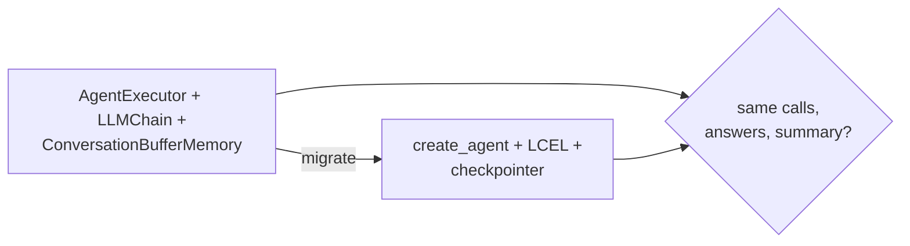

# 24 Migrating Old Code

<!-- generated by scripts/render_docs.py; edit scripts/scenario_notes.py or the module docstring -->

**Concept:** AgentExecutor -> create_agent, LLMChain -> LCEL, ConversationBufferMemory -> checkpointer + thread_id, legacy imports -> langchain-classic  
**Client (fictional):** Ferrowind Insurance: FNOL bot migrated from AgentExecutor (insurance)  
**Code:** [`src/lcstack/scenarios/s24_migration.py`](../../src/lcstack/scenarios/s24_migration.py)  
**Run:** `lcstack run 24`

## Purpose

pre-1.0 patterns and their replacements, with behaviour parity checked.

Client: Ferrowind Insurance's FNOL bot was written with AgentExecutor, LLMChain and
ConversationBufferMemory. The migration moves it to create_agent, an LCEL pipe and a checkpointer with
thread_id, and proves that the same input produces the same tool calls and answers. The legacy code is
kept, clearly labelled, in src/lcstack/legacy/.

## Flow



## How it works

- The legacy bot (labelled LEGACY in `src/lcstack/legacy/fnol_bot.py`) and the migrated agent answer the same two turns.
- Tool calls, answers, the follow-up and the summary are compared; all four must match.

## Code excerpts

`modern_run`:

```python
def modern_run(question: str, followup: str) -> dict:
    model = scripted(PLAYBOOK, name="modern")
    agent = create_agent(
        model, [check_policy, open_claim], system_prompt="You take first notice of loss for Ferrowind Insurance.", checkpointer=memory_saver()
    )
    cfg = {"configurable": {"thread_id": "fnol-1"}}
    first = agent.invoke({"messages": [{"role": "user", "content": question}]}, cfg)
    second = agent.invoke({"messages": [{"role": "user", "content": followup}]}, cfg)
    summary = (PromptTemplate.from_template("Summarize this claim for the adjuster: {text}") | model | StrOutputParser()).invoke({"text": question})
    calls = [(tc["name"], tc["args"]) for m in first["messages"] for tc in getattr(m, "tool_calls", [])]
    return {"calls": calls, "answer": first["messages"][-1].content, "followup": second["messages"][-1].content, "summary": summary}
```

## Real output

Produced by `lcstack run 24` with the offline scripted model (no API keys). Regenerate with `python scripts/render_docs.py`.

```text
Ferrowind Insurance - FNOL bot migration parity

old pattern                              new pattern
initialize_agent, AgentExecutor          langchain.agents.create_agent
langgraph.prebuilt.create_react_agent    create_agent with middleware
LLMChain, RetrievalQA                    LCEL pipes, or an agent with a retriever tool
ConversationBufferMemory                 a checkpointer plus thread_id
legacy chains and imports                the langchain-classic package

calls     SAME: [('check_policy', {'policy_id': 'FW-HO-2207'}), ('open_claim', {'policy_id': 'FW-HO-2207', 'loss_type': 'hail'})]
answer    SAME: Claim CL-4490 is open. In force, deductible 500.00.
followup  SAME: You reported on policy FW-HO-2207.
summary   SAME: Hail damage to roof and car; policy in force; claim opened.
```

## Tests

- `tests/test_s24_migration.py`: `test_create_agent_matches_legacy_agentexecutor`, `test_legacy_module_is_labelled`, `test_import_lint_flags_pre_1_0_and_repo_is_clean`
- `tests/test_scenarios.py`: `test_scenario_runs_and_is_deterministic`, `test_scenario_has_readme_and_module`

## Gotchas

- Memory moves from a memory object to `thread_id` on a checkpointer.
- Legacy classes need `langchain-classic` installed.

## Interview points

- Migrate behind a parity test, not by rewriting and hoping.
- Keep the legacy code until the parity test has run in production traffic.

---

Section titles follow the *LangChain & LangGraph Cheat Sheet* by AI Engineering Insider; all text and code here are original.
