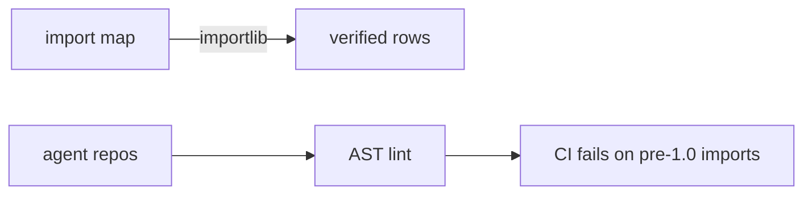

# 25 Import Map

<!-- generated by scripts/render_docs.py; edit scripts/scenario_notes.py or the module docstring -->

**Concept:** Where each building block lives in 1.x (verified by import), and an AST linter that flags pre-1.0 imports  
**Client (fictional):** Quillmere Home Loans: import audit across internal agent repos (mortgage)  
**Code:** [`src/lcstack/scenarios/s25_import_map.py`](../../src/lcstack/scenarios/s25_import_map.py)  
**Run:** `lcstack run 25`

## Purpose

where things live in 1.x, verified, plus a linter for pre-1.0 imports.

Client: Quillmere Home Loans has a dozen internal agent repos written against older tutorials. Their
platform team wants (a) a cheat table of where each building block lives now, checked against the
installed versions rather than memory, and (b) ``lcstack lint-imports`` to flag old imports in CI.

## Flow



## How it works

- Each row of the import map is imported from the installed packages and the symbols are counted.
- `lcstack lint-imports` parses Python files and flags pre-1.0 imports with the replacement; CI runs it on this repo.

## Code excerpts

`verify_map`:

```python
def verify_map() -> list[tuple[str, str, int, int]]:
    rows = []
    for need, module, names in IMPORT_MAP:
        try:
            mod = importlib.import_module(module)
            ok = sum(hasattr(mod, n) for n in names)
        except ImportError:
            ok = 0
        rows.append((need, module, ok, len(names)))
    return rows
```

`lint_source`:

```python
def lint_source(src: str, filename: str = "<src>") -> list[str]:
    findings = []
    for node in ast.walk(ast.parse(src, filename)):
        if isinstance(node, ast.ImportFrom) and node.module:
            mods, names = [node.module], {a.name for a in node.names}
        elif isinstance(node, ast.Import):
            mods, names = [a.name for a in node.names], set()
        else:
            continue
        for mod in mods:
            for prefix, bad, advice in RULES:
                if (mod == prefix or mod.startswith(prefix + ".")) and (bad is None or names & bad):
                    findings.append(f"{filename}:{node.lineno}: {mod} -> {advice}")
    return findings
```

## Real output

Produced by `lcstack run 25` with the offline scripted model (no API keys). Regenerate with `python scripts/render_docs.py`.

```text
Quillmere Home Loans - import map for LangChain / LangGraph / LangSmith 1.x

need                         import from                      names found
Agents, middleware           langchain.agents                 2/2
Agents, middleware           langchain.agents.middleware      4/4
Models, embeddings           langchain.chat_models            1/1
Models, embeddings           langchain.embeddings             1/1
Tools                        langchain.tools                  3/3
Prompts, parsers             langchain_core.prompts           2/2
Prompts, parsers             langchain_core.output_parsers    2/2
Messages                     langchain_core.messages          4/4
Graph, state                 langgraph.graph                  4/4
Graph, state                 langgraph.graph.message          1/1
Command, Send, interrupt     langgraph.types                  4/4
Functional API               langgraph.func                   2/2
Prebuilt graph parts         langgraph.prebuilt               2/2
Checkpointers                langgraph.checkpoint.memory      1/1
Checkpointers                langgraph.checkpoint.sqlite      1/1
Checkpointers                langgraph.checkpoint.postgres    1/1
Stores                       langgraph.store.memory           1/1
Runtime context              langgraph.runtime                1/1
Tracing, evaluation          langsmith                        3/3
MCP tools                    langchain_mcp_adapters.client    1/1
Legacy (only for migration)  langchain_classic.agents         1/1

lint of a pre-1.0 Quillmere service (rate_lock_bot.py):
  rate_lock_bot.py:1: langchain.agents -> use langchain.agents.create_agent
  rate_lock_bot.py:2: langchain.chains -> use an LCEL pipe or an agent with a retriever tool (old chains live in langchain_classic)
  rate_lock_bot.py:3: langchain.memory -> use a checkpointer plus thread_id
  rate_lock_bot.py:4: langchain.chat_models -> import the class from its provider package
  rate_lock_bot.py:5: langgraph.prebuilt -> use langchain.agents.create_agent (with middleware)
this repo: 0 pre-1.0 imports in scenarios/capstone/core; 3 in the labelled legacy folder (expected)
```

## Tests

- `tests/test_s24_migration.py`: `test_create_agent_matches_legacy_agentexecutor`, `test_legacy_module_is_labelled`, `test_import_lint_flags_pre_1_0_and_repo_is_clean`
- `tests/test_scenarios.py`: `test_scenario_runs_and_is_deterministic`, `test_scenario_has_readme_and_module`

## Gotchas

- `langgraph.prebuilt.create_react_agent` is superseded by `langchain.agents.create_agent`.
- Old `langchain.chat_models` provider classes moved to integration packages.

## Interview points

- Verify the map against installed versions, not memory.
- An import linter is a cheap guard during migrations.

---

Section titles follow the *LangChain & LangGraph Cheat Sheet* by AI Engineering Insider; all text and code here are original.
